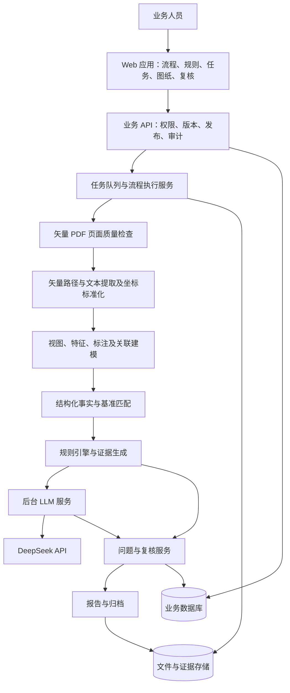

# 基于矢量 PDF 的 CAD 图纸智能检查应用方案

版本：v1.3 草案｜日期：2026 年 10 月 10 日

将现有基于矢量 PDF 的 POC 中图纸解析、基准学习、规则检查、证据定位和人工反馈能力，整合为业务人员可以持续使用的 Web 应用。输入为 CAD 系统导出的矢量 PDF。用户在前端完成流程配置、规则维护、任务发起、执行监控、问题复核和结果归档；后台负责持久化、任务调度、PDF 矢量与文本解析、规则执行及 DeepSeek API 调用。

“在前端实现”指所有业务操作都有可视化入口。规则定义和流程编排由前端管理，正式执行和版本记录由后台统一负责，保证关闭浏览器后任务仍能运行，且多人使用时结果一致。

## 1 建设基础与范围

本方案采用“矢量 PDF → 矢量路径与文本提取 → 视图、特征、标注及关联建模 → 基准匹配与规则检查 → DeepSeek 解释与建议 → 人工复核”的技术路径。项目目录中的 PDF 基准学习、规则版本、检查记录和反馈记录，是应用迁移的数据与能力来源。现有前端演示使用模拟解析结果，不能直接视为已完成生产系统。

本方案聚焦二维矢量 PDF 图纸检查，包括标准图纸的基准学习、待检图纸的结构化提取、同类图纸对比和检查闭环。NX 等 CAD 软件仅作为 PDF 的上游导出工具，应用运行不依赖 NX 原生文件或 NX API。本期不包含 DWG/DXF 输入、格式转换或解析，也不包含原生三维模型检查。

上传后按页检查矢量路径、可提取文本、嵌入图像和页面完整性。纯扫描 PDF 不进入本期自动检查范围；混合页面或文字转曲造成的不可提取区域需要显式标识，进入人工确认或提示重新导出。局部不可解析时保留可验证内容，相关检查项标记为无法判定，不能将整页计为全部通过。

产品数量、专项规则和跨页检查范围需在实施清单中冻结。PLM 集成按独立需求评估。本方案不直接沿用旧 POC 的 12 周、2.55 FTE 或历史生产报价作为本次承诺。

### 矢量 PDF 解析与检查边界

1. 提取页面尺寸、旋转、裁剪信息，以及矢量路径、线宽、线型、文本内容与位置，保留来源页码和坐标。
2. 将路径和文字组织为视图、轮廓、尺寸线、引出线、尺寸文字、基准符号及技术要求的候选对象；识别结果记录依据和置信度。
3. 建立“标注—引线—几何对象—视图”关系，在前端支持人工确认和修正后发布基准。
4. 对待检图纸进行页面、视图及局部区域匹配，结合经确认的特征和标注执行规则；位置或排版变化与工程内容变化分别呈现。
5. PDF 路径不直接等同于 CAD 原生特征，尺寸文字也不天然关联几何对象。工程尺寸优先采用已确认关联的标注值；只有视图比例、单位和投影条件经过验证时，才允许从页面几何换算尺寸，并记录换算依据。
6. 三维壁厚、装配干涉、特征树和原生参数约束不在本期检查范围。证据不足的二维关系进入人工复核。

## 2 从 POC 到应用的变化

| 现有 POC 能力 | 应用中的实现 | 交付结果 |
| --- | --- | --- |
| 文件与目录管理 | 项目、产品、图纸版本和文件中心 | 用户可上传、检索和追溯图纸 |
| 手动执行解析与检查 | 流程模板、任务队列和执行面板 | 可发起、监控、取消及重试 |
| 基准学习结果 | 项目内基准学习视图和人工确认队列 | 可查看视图、特征、标注及关联 |
| JSON 规则文件 | 可视化规则编辑器与发布流程 | 可配置、试运行、比较和发布版本 |
| 检查输出文件 | 项目内图纸与问题联动的检查复核视图 | 问题能定位、解释和分派 |
| 人工反馈记录 | 误报、漏报与整改闭环 | 反馈形成待评审规则提案 |
| LLM 文本生成 | 后台 DeepSeek 服务与前端 AI 面板 | 建议可引用、可复核、可追溯 |

## 3 前端功能与页面设计

Web 默认直接进入项目工作界面，不设置独立首页工作台或统计总览页。已有项目时，进入最近使用且仍有访问权限的项目，并恢复上次打开的图纸或任务；原对象不可用时回到该项目图纸列表。首次使用且无项目时，显示创建项目入口；没有创建权限时显示可用项目为空的提示。多个项目通过顶部项目选择器切换，项目选择器同时提供新建和项目管理入口。

项目工作界面以当前项目为上下文：顶部显示项目名称、项目切换及上传图纸、新建检查等操作；左侧展示产品与图纸树；中间展示 PDF 或当前功能视图；右侧按选中对象展示属性、规则依据、问题和操作。图纸列表直接显示解析与检查状态，项目内任务入口显示运行、待复核及失败数量，点击即可定位到对应记录。

基准学习、检查复核、流程、任务、整改和报告均为项目内可切换视图。切换视图时保留当前图纸或任务上下文。产品类别与规则库为跨项目设置，从页眉的全局入口进入；项目内仅查看当前适用的规则包版本和检查结果。用户无需经过首页或汇总页即可开始上传、检查或复核。

| 项目内视图或管理入口 | 用户可完成的操作 | 核心可视化内容 |
| --- | --- | --- |
| 项目工作界面（默认入口） | 建立产品、上传矢量 PDF、选择图纸或任务、维护版本、指定适用基准并发起检查 | 产品与图纸树、PDF 预览、图纸列表状态和任务提示 |
| 基准学习 | 发起学习、框选区域、确认或修正识别对象与关联、提交基准发布 | 图纸预览、视图分区、特征与标注关系、待确认项 |
| 流程设计器 | 新建模板、配置节点顺序、条件分支、参数和复核角色 | 节点画布、连接关系、参数面板、版本差异 |
| 全局产品类别与规则中心 | 管理产品类别；按类别新建规则、设置条件与阈值、试运行和发布 | 类别树、规则表单、适用范围、回归结果与版本 |
| 检查任务中心 | 选图纸、基准和规则包，启动批量检查，取消或重试 | 每阶段状态、耗时、处理计数、失败原因及产物 |
| 检查复核 | 定位问题、查看依据、确认、驳回、补报漏检和分派整改 | 图纸高亮、基准对照、实际与期望值、AI 建议 |
| 整改与复检 | 上传修订图纸、发起关联复检、确认问题关闭 | 新旧版本对照、遗留问题、新增问题及关闭记录 |
| 知识与 AI 管理 | 维护规范版本、测试检索、管理提示模板和模型配置引用 | 引用条款、输出样例、调用耗时、失败率和用量 |
| 项目报告与记录 | 导出结果、查看项目内审计记录和历史报告 | 报告快照、规则履历、任务追踪与操作记录 |
| 系统设置（按权限显示） | 管理用户、角色、权限和服务连接 | 配置状态及操作记录 |

进入检查复核视图时，左侧产品与图纸树可折叠并切换为可筛选的问题清单，中间保持图纸及证据标记，右侧展示规则、测量结果、引用依据、DeepSeek 建议和复核操作。点击问题定位到对应页、视图或对象；点击图纸对象可反查关联问题。任务进度和失败提示在当前项目内更新，点击提示进入对应任务详情。

## 4 可视化流程管理

提供三个内置模板，首期围绕已有处理节点进行配置。

**基准学习流程：** 上传标准矢量 PDF → 页面质量检查 → 矢量与文本提取及坐标标准化 → 视图和特征提取 → 标注关联 → 人工确认 → 基准版本发布。

**图纸检查流程：** 选择待检矢量 PDF 与检查模板 → 锁定输入及配置版本 → 页面质量检查 → 矢量与文本解析 → 视图及标注关联 → 基准匹配 → 规则检查 → 证据生成 → DeepSeek 解释与建议 → 人工复核 → 报告归档。

**反馈改进流程：** 提交误报或漏报 → 形成规则修改草案 → 样本试运行 → 回归比较 → 人工审核 → 发布新规则版本。

流程节点支持配置输入、输出、超时、重试次数、适用页面或视图、失败处理方式和责任角色。前端保存前检查必填参数、节点输入输出兼容性、连线和不可达节点；后台再次校验发布内容。首期采用有向无环流程，复检创建关联新任务。

流程模板状态为草稿、待审核、已发布、已停用。执行实例锁定发布版本；正在执行的任务不随模板编辑变化。任务整体状态区分排队中、执行中、待复核、已归档、失败和已取消；每个节点另行记录等待、运行、成功、失败或跳过。

进度优先展示已完成阶段、已处理文件数和对象数。没有可靠处理总量时显示“处理中”和耗时。失败节点支持从已验证检查点创建重试记录；变更输入或规则后必须建立新的执行实例。

## 5 可视化规则管理

规则按产品类别跨项目管理。管理员先维护产品类别，再为类别建立可发布的规则包；多个项目可关联同一类别并复用同一规则包。创建项目时必须选择一个主产品类别，首期一个项目关联一个类别，后续需要混合产品时通过子项目或多类别关联扩展。历史项目若尚无类别，需补齐关联后才能发起新检查。

项目不复制规则正文，只保存产品类别 ID 和所选规则包版本。新任务默认采用该类别当前已发布版本，启动时锁定版本；后续规则发布不改变既有任务或报告。项目可以选择另一已发布版本进行验证，但不能在项目内直接修改全局规则。需要项目专用差异时，先形成规则提案，在类别层审核和回归后发布。

规则编辑以业务表单为主，核心字段包括规则编号、名称、适用产品与对象、检查类型、数据字段、比较条件、阈值与单位、严重等级、规范来源、证据要求、责任人和版本。

| 规则类型 | 前端配置示例 | 执行依据 |
| --- | --- | --- |
| 完整性 | 指定标题栏字段不得为空 | 结构化字段及来源位置 |
| 数值与公差 | 指定尺寸标注的名义值及公差应符合基准要求 | PDF 中提取并确认的标注值、单位、上下限和关联对象 |
| 基准一致性 | 指定特征与批准基准保持一致 | 基准版本与目标特征映射 |
| 关系检查 | 重复二维特征数量与角度分布满足约束 | 已确认的视图、投影条件、二维几何和关联标注 |
| 语义辅助 | 技术要求与指定规范条款进行比对 | 检索条款、结构化文字与 LLM 候选意见 |

用户可从模板创建规则，也可用自然语言描述检查意图，由 DeepSeek 生成草案。草案必须映射到系统已有检查算子，通过字段校验、样本验证和人工审核后才能发布。需要新几何算法的规则进入开发待办，前端明确显示“尚无执行能力”。

缺失数据、单位无法确定、匹配置信度不足或不支持的对象，应输出“待确认”“无法判定”或“不适用”，并注明原因；不能记为通过。规则运行结果与问题严重等级分别管理。

规则生命周期：草稿 → 试运行 → 回归验证 → 审核 → 发布 → 停用。发布版本不可覆盖修改，后续编辑形成新版本；规则回退通过重新指定已发布版本完成。反馈形成提案，不自动修改生效规则。

## 6 DeepSeek API 能力设计

DeepSeek 继续承担 LLM 能力，统一经后台服务调用。前端通过业务接口请求规则草案、问题解释、整改建议和报告摘要；API 密钥存放在服务端密钥配置中，前端仅显示连接状态、配置名称和可查看的运行记录。

| 场景 | 提交给 DeepSeek 的内容 | 输出与限制 |
| --- | --- | --- |
| 规则草案 | 用户意图、允许的字段与算子、相关规范 | 结构化草案，发布前必须验证 |
| 问题解释 | 已确定的问题、实际值、期望值及证据引用 | 可读说明，事实字段保持不变 |
| 整改建议 | 问题事实、规范条款和适用历史案例 | 建议动作、复核要点及引用编号 |
| 语义辅助检查 | 抽取文字、适用规则与来源条款 | 候选疑点，进入人工确认 |
| 报告摘要 | 已确认问题与覆盖范围 | 汇总结果，明确未检查项 |

后台对输出结构、引用编号和事实一致性进行校验；不合格输出记录失败或有限重试。模型建议与规则判定分开存储和展示，LLM 不修改几何事实、实测值和确定性规则结论。

每次调用记录任务、调用场景、模型标识、提示模板版本、输入摘要、引用来源、响应状态、耗时及接口返回的用量信息。模型名称、接口地址和可选参数在实施时以现有 DeepSeek 接入配置及官方文档核实，不在本方案绑定未经验证的型号或多模态能力。

DeepSeek 超时或不可用时，保留已完成的规则结果和证据，标记“AI 建议待生成”，恢复后单独补跑。依赖语义分析的检查项保持待处理状态，不计为通过。矢量 PDF 先经解析形成文本、几何及标注关系数据，再将相关结构化信息送入 LLM 流程；图纸渲染用于前端预览和证据展示。

## 7 系统架构与职责

前端承担交互、图纸渲染、业务配置和运行状态展示；后台承担权限验证、配置持久化、版本冻结、执行和审计。解析 Worker 复用经验证的 POC 脚本，增加统一输入输出、错误码和任务隔离。浏览器离线或刷新后，可重新读取后台状态继续操作。

建议沿用 Python PDF 解析能力，将后台封装为业务 API 与异步 Worker；前端使用团队统一的 Web 技术栈。数据库保存任务和业务记录，文件存储保存原始 PDF、提取数据、页面预览、证据和报告。具体框架、部署平台和容量在环境确认后选定。

## 8 数据与追溯设计

核心对象包括产品类别、项目、产品、图纸版本、文件、基准版本、流程模板版本、规则版本、规则包、执行实例、节点执行记录、结构化事实、问题、证据、复核、整改、LLM 调用和报告快照。项目保存产品类别 ID；规则包关联产品类别，允许多个项目引用同一发布版本。

每次执行冻结：文件校验值、图纸版本、基准版本、流程版本、规则包版本、解析器版本、提示模板版本及所用模型标识。复核结果通过新增记录保存；重新生成报告产生新快照，历史报告保留当时结论。

证据保存 PDF 页码、视图、派生对象编号、源路径或文本引用、坐标区域和坐标变换信息，确保前端缩放、平移后仍能正确定位。对象编号属于本次解析结果，跨版本通过显式匹配关系关联。页面旋转、裁剪、PDF 坐标与屏幕坐标映射需保留；涉及工程尺寸换算时另存视图比例、单位和验证记录。整改后的 PDF 形成新版本和新检查任务，通过关联关系比较问题状态。

## 9 角色和发布控制

设计人员上传图纸、发起检查和提交整改；检查人员复核问题、补报漏检并确认关闭；规则管理员维护模板、规则和回归样本；规则审核人员批准规则及基准发布；系统管理员维护用户、连接配置和运行环境。

权限在后台校验，并按项目约束文件和报告访问。规则发布、基准发布、人工裁决和任务重跑均记录操作者、时间和版本。发给 DeepSeek 的内容按项目配置控制，仅提供完成当前场景所需的结构化事实和规范片段。

## 10 实施工作包

| 阶段 | 建设内容 | 完成条件 |
| --- | --- | --- |
| 需求与能力核查 | 盘点矢量 PDF 解析脚本、样本、规则及现有 DeepSeek 接口；验证文本、路径和标注关联能力 | PDF 导出要求、页面支持矩阵和验收集冻结 |
| 应用基础闭环 | 项目直接进入与切换、图纸、任务、异步执行、结果和持久化 | 用户在项目工作界面从上传到查看结果完成闭环 |
| 流程与规则可视化 | 流程配置、规则表单、样本试运行、回归与发布 | 授权人员能在界面完成配置到发布 |
| 基准与复核闭环 | 基准确认、证据联动、误报漏报、整改复检 | 一个真实案例完成可追溯闭环 |
| DeepSeek 联调与运行管理 | 草案、解释、建议、摘要、失败补跑和调用记录 | 真实接口链路及故障降级验证通过 |
| 试点与上线 | 历史数据迁移、权限、并发、恢复、培训和验收 | 业务和运行指标共同验收 |

每个阶段以可操作应用功能作为评审对象。工作量估算应覆盖前端交互、后端服务化、数据迁移、规则适配、DeepSeek 联调与测试，单独核算产品专项能力。

## 11 验收标准

| 验收项 | 验收方法 |
| --- | --- |
| 项目直接进入 | 登录后直接进入可访问的最近项目；首次无项目时提供创建入口或权限提示；切换项目后仅展示对应项目数据，无独立首页工作台 |
| 类别与项目关联 | 新项目必须选择产品类别；已有项目可补充关联；未关联项目不能发起新检查 |
| 业务全流程 | 业务人员从上传矢量 PDF、选模板、检查到复核归档，无需手动执行脚本 |
| PDF 解析与关联 | 使用人工标注样本验证路径、文本、视图及标注关系；覆盖多页、旋转、裁剪、局部比例和文字转曲 |
| 输入适用性 | 纯扫描或局部不可解析内容有明确提示；相关检查不被误计为通过 |
| 流程管理 | 新版本可发布，执行实例版本固定；刷新或关闭浏览器不影响后台执行 |
| 规则管理 | 规则在产品类别层跨项目维护与发布；同类项目可复用发布版本；无算子的规则不能发布为可执行规则 |
| 证据定位 | 每个已确认问题可打开对应图纸位置、规则依据和相关事实 |
| DeepSeek 集成 | 使用真实接口完成建议生成，密钥不进入浏览器；故障时状态明确且结果不丢失 |
| 复核整改 | 确认、驳回、补报、整改和复检均有责任人及时间记录 |
| 历史追溯 | 任一报告可追溯到输入、基准、流程、规则及模型调用记录 |
| 异常与恢复 | 覆盖解析失败、模型超时、取消、重复提交和重试，避免重复结果 |
| 检查质量 | 沿用 POC 目标作为讨论起点，按冻结测试集计算 Precision、Recall 和证据定位率 |

本次矢量 PDF POC 的验收指标在冻结样本集后确定，不直接套用其他输入路线的目标。验收分别统计文本和矢量提取完整率、标注与几何关联准确率、确定性规则 Precision、Critical/Major 问题 Recall、证据定位率及无法判定率。各指标明确人工真值、缺陷等级及分母，按产品、页面复杂度和规则类型分组报告；未覆盖页和不支持内容单独计数，不能从报告中隐去。

运行性能指标在代表图纸大小、页数、对象数量、批量规模和并发人数确定后设定，单独统计解析、规则计算、DeepSeek 响应及人工等待时间。

## 12 方案依据与后续设计输入

本方案以项目中现有矢量 PDF 基准学习和检查资产为技术基础，包括 `skills/nx-pdf-drawing-inspection`、`cad-data`、`cad-rules` 和 `cad-audit`。此前详细设计和演示中的前端管理思路可复用，输入范围以本方案的矢量 PDF 定义为准，LLM 统一由后台 DeepSeek API 提供。

进入详细设计前需落实：首批产品、矢量 PDF 导出要求与页面质量、实际可运行的解析及规则清单、部署和身份认证方式、现有 DeepSeek 服务配置、规范来源与授权范围、代表样本及人工真值。这些输入用于确认开发排期和报价。当前开发版本已实现项目、类别、PDF 上传预览、内容流矢量清单、按类别发布的 PDF 输入质量规则、项目内分析→检查→可选人工复核的流程配置和版本化运行记录，以及逐项输入质量复核和不可变 HTML 报告快照；CAD 语义解析和规则、对象级证据定位、完整流程编排、审批权限、可靠任务队列及真实 DeepSeek API 联调尚未完成。
